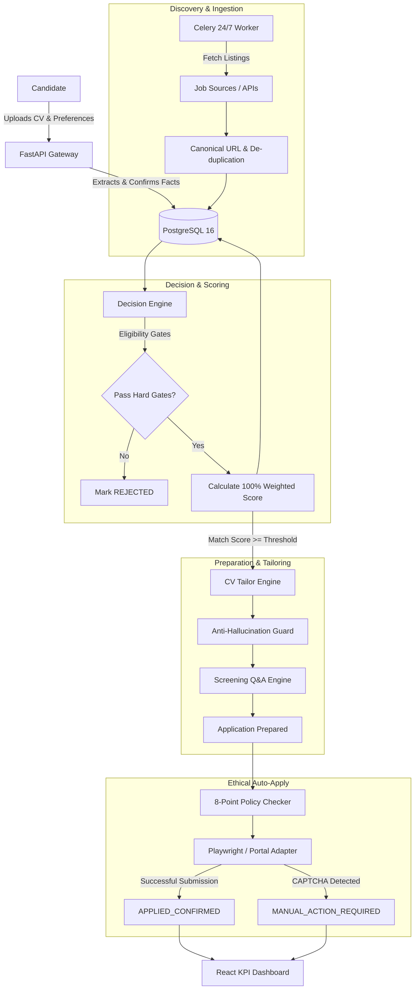

# JobPilot AI 🚀

[](https://github.com/AbdulRasheedYP/jobpilot-ai/actions)
[](https://www.python.org/)
[](https://fastapi.tiangolo.com/)
[](https://react.dev/)
[]()
[](https://opensource.org/licenses/MIT)

> **Autonomous, ethical, self-hosted AI agent for end-to-end software engineering job discovery, profile matching, tailored resume generation, and automated applications.**

JobPilot AI is an enterprise-grade personal agent designed to run 24/7 on private cloud infrastructure or local servers. It eliminates the tedious overhead of job applications while adhering to strict **Zero-Hallucination** rules, **deterministic decision scoring**, and **ethical web automation** policies.

---

## 🌟 Key Engineering Highlights

- **🛡️ Zero-Hallucination Policy:** Candidate CVs undergo structured extraction via LLMs (Google Gemini / Groq / Ollama), but all facts must be verified by the candidate before use. An AST-level anti-hallucination gate (`validate_anti_hallucination`) dynamically strips any unsupported skills or inflated claims before resume generation.
- **⚖️ Deterministic Decision Engine:** Free of stochastic prompt guesswork. Features 4 strict eligibility gates (Company exclusion, Role suitability, Work mode / location, Sponsorship requirements) combined with a 100% weighted scoring algorithm (Skills 35%, Role Fit 25%, Experience 20%, Education 10%, Location 10%).
- **🤖 Ethical & Safe Automation:** Auto-apply submits applications exclusively through permitted job sources and dedicated career portals. Safely halts upon encountering CAPTCHA, Cloudflare, or MFA challenges, marking the application as `MANUAL_ACTION_REQUIRED` without attempting to bypass security boundaries.
- **🔄 Pluggable LLM Provider Layer:** Zero vendor lock-in. Switch seamlessly between Google Gemini (`gemini-2.5-flash`), Groq (`llama-3.3-70b-versatile`), and self-hosted Ollama (`llama3.2`) through clean dependency injection.
- **⚡ 24/7 Background Orchestrator:** Distributed task scheduling backed by Celery and Redis. Handles continuous job ingestion, rate limiting, retry backoff, and periodic health checks with audit logging.
- **📊 Real-Time Control Dashboard:** Single Page Application built with React and Tailwind CSS featuring executive KPI metrics, live application tracking, and real-time agent lifecycle controls (`Run`, `Pause`, `Resume`, `Stop`).

---

## 🏗️ Architecture & Data Flow



---

## 🛠️ Tech Stack

| Layer | Technology | Purpose |
|---|---|---|
| **Frontend** | React 18, JavaScript (ES6+), Tailwind CSS, Lucide Icons, Vite | Single Page Dashboard with zero TypeScript overhead |
| **Backend API** | Python 3.11+, FastAPI, Pydantic v2, SQLAlchemy 2.0 | Async/sync high-performance RESTful API |
| **Database** | PostgreSQL 16 (with JSONB & UUIDs), Alembic | Relational schema with full audit event logging |
| **Background Queue** | Celery 5.4, Redis 7 (Alpine) | Distributed periodic tasks and application dispatchers |
| **AI / LLM** | Google Gemini SDK, Groq SDK, Ollama | Structured CV parsing, ATS tailoring, answer generation |
| **Automation** | Playwright, HTTPX | Career portal automation & in-process mock portal |
| **DevOps / Proxy** | Docker, Docker Compose, Nginx, GitHub Actions | Multi-stage production containerization and CI pipeline |

---

## 🚀 Quick Start

### Option A: Run with Docker Compose (Recommended)

1. **Clone the repository:**
   ```bash
   git clone git@github.com:AbdulRasheedYP/jobpilot-ai.git
   cd jobpilot-ai
   ```

2. **Configure environment:**
   ```bash
   cp .env.example .env
   # Add your GEMINI_API_KEY or GROQ_API_KEY in .env
   ```

3. **Start the production stack:**
   ```bash
   docker compose -f docker-compose.prod.yml up -d --build
   ```

4. **Access the application:**
   - **Frontend Dashboard:** [http://localhost](http://localhost)
   - **Interactive API Docs (Swagger):** [http://localhost/docs](http://localhost/docs)
   - **Backend Health Check:** [http://localhost/api/v1/health](http://localhost/api/v1/health)

---

### Option B: Local Development Setup

#### 1. Backend Setup
```bash
# Create virtual environment
python3 -m venv .venv
source .venv/bin/activate

# Install dependencies
pip install -r backend/requirements.txt
playwright install --with-deps chromium

# Run database migrations
alembic upgrade head

# Start FastAPI server
uvicorn backend.app.main:app --host 0.0.0.0 --port 8000 --reload
```

#### 2. Start Celery Worker (in a separate terminal)
```bash
source .venv/bin/activate
celery -A backend.app.workers.celery_app worker --loglevel=info
```

#### 3. Frontend Setup (in a separate terminal)
```bash
cd frontend
npm install
npm run dev
# Vite runs at http://localhost:5173
```

---

## 🧪 Testing & Verification

The test suite covers end-to-end functionality including URL canonicalization, ATS anti-hallucination verification, JWT authentication, Celery tasks, matching scoring algorithms, and automated mock submissions.

```bash
# Run backend test suite
.venv/bin/pytest backend/tests/ -v

# Run frontend production build test
npm run build --prefix frontend
```

**Results:**
```text
backend/tests/test_adapters.py ......................... PASSED [ 14%]
backend/tests/test_agent.py ............................ PASSED [ 19%]
backend/tests/test_applications.py ..................... PASSED [ 23%]
backend/tests/test_auth.py ............................. PASSED [ 36%]
backend/tests/test_auto_apply.py ....................... PASSED [ 44%]
backend/tests/test_celery.py ........................... PASSED [ 51%]
backend/tests/test_health.py ........................... PASSED [ 53%]
backend/tests/test_jobs.py ............................. PASSED [ 57%]
backend/tests/test_llm_provider.py ..................... PASSED [ 63%]
backend/tests/test_matching.py ......................... PASSED [ 72%]
backend/tests/test_models.py ........................... PASSED [ 76%]
backend/tests/test_preferences.py ...................... PASSED [ 80%]
backend/tests/test_profile.py .......................... PASSED [ 87%]
backend/tests/test_resumes.py .......................... PASSED [ 95%]
backend/tests/test_sources.py .......................... PASSED [100%]

============================== 47 passed in 6.38s ==============================
✓ built frontend in 1.46s (0 errors)
```

---

## 📡 API Endpoints Overview

| Category | Method | Endpoint | Description |
|---|---|---|---|
| **Health** | `GET` | `/api/v1/health` | Service and database health status |
| **Authentication** | `POST` | `/api/v1/auth/login` | Single-user OAuth2 password flow & JWT generation |
| **Profile & CV** | `GET, PUT` | `/api/v1/profile` | Manage verified candidate profile |
| | `POST` | `/api/v1/resumes` | Upload candidate CV (`.pdf`, `.docx`, `.txt`) |
| | `PUT` | `/api/v1/resumes/{id}/confirm` | Zero-Hallucination confirmation gate |
| **Preferences** | `GET, PUT` | `/api/v1/preferences` | Configure target roles, locations, minimum score |
| **Discovery** | `GET, PATCH`| `/api/v1/sources` | Enable/disable permitted job sources |
| | `GET` | `/api/v1/jobs` | Paginated discovered job listings |
| | `POST` | `/api/v1/jobs/sync` | Trigger asynchronous job ingestion |
| **Matching** | `GET` | `/api/v1/matches` | Filter scored matches by minimum score / status |
| | `POST` | `/api/v1/matches/evaluate` | Run deterministic decision engine on active jobs |
| **Applications** | `POST` | `/api/v1/applications/prepare`| Generate tailored ATS resume & screening Q&As |
| | `POST` | `/api/v1/applications/{id}/submit`| Submit single application via verified portal adapter |
| | `POST` | `/api/v1/applications/auto-apply/run`| Execute batch auto-apply for eligible jobs |
| **Agent Ops** | `GET` | `/api/v1/agent/dashboard` | Aggregated KPI metrics & recent activity feed |
| | `POST` | `/api/v1/agent/run` | Launch full autonomous cycle |
| | `POST` | `/api/v1/agent/pause` | Pause active autonomous run |
| | `POST` | `/api/v1/agent/resume` | Resume paused run |
| | `POST` | `/api/v1/agent/stop` | Gracefully terminate agent run |

---

## 📂 Project Structure

```text
jobpilot-ai/
├── backend/
│   ├── app/
│   │   ├── adapters/          # Job source & portal automation adapters
│   │   ├── api/v1/            # FastAPI REST endpoints
│   │   ├── core/              # Config, database, security, and LLM providers
│   │   ├── models/            # SQLAlchemy 2.0 ORM models
│   │   ├── schemas/           # Pydantic v2 request/response schemas
│   │   ├── services/          # Decision engine, CV tailor, auto-apply policy
│   │   └── workers/           # Celery application & asynchronous tasks
│   ├── tests/                 # Full Pytest test suite (47 tests)
│   ├── Dockerfile             # Multi-stage production Python build
│   └── requirements.txt
├── frontend/
│   ├── src/
│   │   ├── App.jsx            # React dashboard SPA with KPI tracker
│   │   ├── main.jsx           # App entrypoint
│   │   └── index.css          # Tailwind CSS styles
│   ├── Dockerfile             # Nginx-served static React build
│   └── package.json
├── nginx/
│   └── default.conf           # Reverse proxy configuration
├── scripts/
│   ├── backup_db.sh           # Automated PostgreSQL backup script
│   └── git_commit.sh          # Git author/committer schedule helper
├── docs/                      # Architectural specifications & decision engine rules
├── docker-compose.prod.yml    # Full production container composition
└── README.md
```

---

## ⚖️ Ethical Guidelines & Responsible Use

JobPilot AI adheres strictly to responsible web automation standards:
1. **Respect for Platform Boundaries:** Submissions are performed only on employer portals that permit direct candidate applications or via official APIs.
2. **No CAPTCHA Bypass:** When a bot challenge or multi-factor authentication is detected, JobPilot AI immediately halts and alerts the user (`MANUAL_ACTION_REQUIRED`).
3. **Strict Truthfulness:** The candidate's real qualifications, work history, and skills are never altered, exaggerated, or fabricated.
4. **Rate Limiting & Politeness:** Request intervals and concurrency are strictly capped to prevent undue load on public job portals.

---

## 📄 License

This project is licensed under the MIT License - see the [LICENSE](LICENSE) file for details.